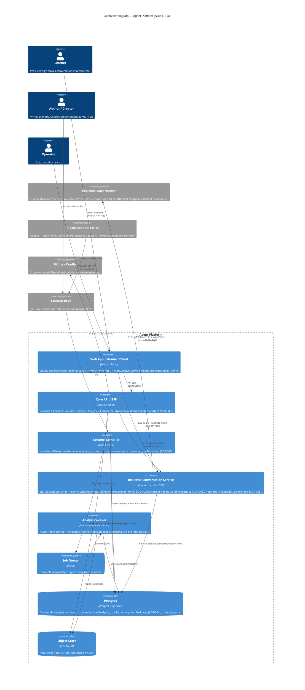

# C4 Container Diagram — Agent Platform

- **Date:** 2026-06-06 · **Author:** Enterprise Architect · **Issue:** SAU-175
- **Source design:** `docs/SAU-171-brandstorm-architecture.md` §5, §7
- **Level:** C4 Level 2 (Containers). Matches the system architecture in design §5.
- **Governing ADRs:** [ADR-001](../adr/ADR-001-scenario-as-core-primitive.md), [ADR-002](../adr/ADR-002-content-as-code.md), [ADR-003](../adr/ADR-003-realtime-voice-build-vs-buy.md), [ADR-005](../adr/ADR-005-multimodal-tool-protocol.md)

## Container diagram (Mermaid C4)

## Reading guide

- **The component that decides the project** is the *Realtime Conversation Service* (design §5). It is drawn as a distinct container precisely so the **external vendor is swappable** behind the `startSession` interface ([ADR-003](../adr/ADR-003-realtime-voice-build-vs-buy.md)). Slice-0 measures vendors against that boundary.
- **Two deliberately novel surfaces** (design §7): the *Content Compiler* and the *Realtime adapter*. Everything else is boring/reused (Next.js, Postgres, Stripe, queue+worker, object store).
- **Authoring is content-as-code** ([ADR-002](../adr/ADR-002-content-as-code.md)): humans and Claude both produce MD → PR → compiler → canonical rows. No path writes canonical content directly to Postgres at runtime.
- **Analysis is async** (off the request path) — sessions stay fast; scoring happens on the worker.
- **History/Analyst are projections** over `session` (ERD) served by the Core API; not separate stores.

## SLI/SLO starting points (to formalize before Slice 0 ships — SOUL: no system ships without SLIs)

| Container | SLI | Provisional SLO |
|---|---|---|
| Realtime Conversation Service | Voice time-to-first-audio (p95) | ≤ 800 ms (validated by Slice-0; [ADR-003](../adr/ADR-003-realtime-voice-build-vs-buy.md) bar) |
| Realtime Conversation Service | Session establishment success rate | ≥ 99% |
| Core API / BFF | Request availability / p95 latency | ≥ 99.9% / ≤ 300 ms |
| Analysis Worker | Job success rate; analysis freshness (p95) | ≥ 99% ; ≤ 2 min after session end |
| Content Compiler | Compile success on valid MD; bad-MD rejection | 100% / 100% (never reaches DB) |

These SLIs feed the observability work ([HEARTBEAT] golden-signal coverage) and must be instrumented and alerting before Slice-0 goes beyond the bench.
